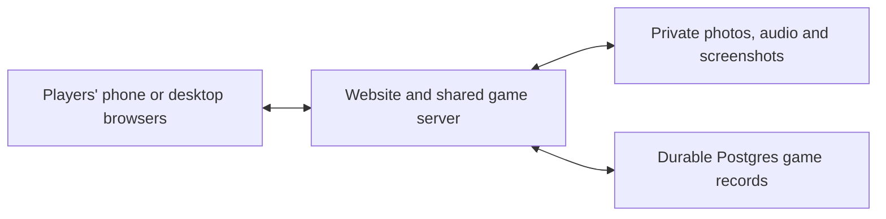

# Photo Fumble — architecture and implementation

Updated 24 October 2026. All five modes and shared multiplayer flow are implemented.
Production targets one paid Render instance and Supabase Free. No cloud resources
are provisioned automatically. Product behavior is defined in the [PRD](PRD.md).

## Implementation map

- `shared/types.ts`: mode, phase, command, receipt, and personalized view contracts.
- `server/engine.ts`: pure rules, role/phase validation, scoring, media authorization,
  and player-filtered snapshots.
- `server/service.ts`: serialized durable mutations, action deduplication, recovery.
- `server/repository.ts`: atomic local-file adapter for development and Supabase RPC
  adapter for production. The database transaction commits state and receipt together.
- `server/media.ts`: content validation, orientation/EXIF normalization, flattened
  screenshot masking, and separately encoded blur derivatives.
- `server/index.ts`: HTTP, signed guest cookies, origin checks, uploads, Socket.IO,
  rate limits, private media access, static frontend, and health checks.
- `client/`: responsive React interface based on Pocket Prints.
- `supabase/migrations/001_initial.sql`: server-only tables and atomic commit RPC.
- `tests/`: engine, persistence, media, and four-browser five-mode walkthrough.

Commands: `npm run dev`, `npm run typecheck`, `npm test`, `npm run test:e2e`,
`npm run build`, `npm start`, and `npm run session:reset -- --confirm`.

HTTP interfaces: `POST /api/session/join`, `GET /api/session`, `POST /api/uploads`,
`GET /api/media/:assetId`, `GET /api/health`. Socket.IO carries `command` with an
acknowledgement and per-player `state` updates. Commands include unique IDs, game
identity, and a phase token. Version changes within the same phase do not reject
legitimate concurrent responses; old game/phase tokens do.

## 1. Smallest useful architecture

Use one application server and one managed private file store. The application server
can serve the website as well as coordinate the game, so a separate frontend hosting
service is optional. A database can be supplied by the storage provider's platform
for durable game records. Supabase provides both storage and Postgres.



The browsers display images and play audio. The server manages players, host controls,
the active game, private roles, answers, votes, and scoring. A dedicated graphics
rendering server or GPU is not required by these mechanics.

### Selected stack

- React with TypeScript for the interface, using the installed frontend and React skills.
- A Node.js backend with WebSockets or Socket.IO for synchronized state changes.
- Private object storage for media; persist a reference to each file rather than
  embedding file contents in game-state updates.
- Durable database snapshots plus action receipts for recovery. Local development
  uses atomic JSON files; production requires Supabase and refuses ephemeral local storage.

Socket.IO is the only realtime synchronization path. No Supabase Realtime, Redis,
or additional frontend host is used. Run only one application instance.

## 2. Data and authority

Maintain these concepts separately:

| Concept | Example contents |
| --- | --- |
| Shared session | Player identities and nicknames, fixed host, waiting newcomers. |
| Current game | Selected mode, participant snapshot, phase, scores, submission order. |
| Submission | Owner, file reference, media type, private correct date/context/stories. |
| Guess or choice | Author, target submission, value, server-recorded ordering. |
| Judging vote | Explanation being judged, voter, yes/no, result. |
| Suspect vote | Voter and suspected impostor; distinct from judging an explanation. |
| Impostor assignment | Private player role and the permitted image derivative. |
| Final ranking | Scores for the completed game and shared winners. |

Use a stable anonymous browser identity in addition to the displayed nickname as a
demo default. Nicknames are labels, not proof of identity or host authority.

The server validates who may act and in which phase, applies points once, and sends
each player only their permitted state. Repeated messages or retries must not award
the same points twice. The host controls progression, but cannot bypass the required
final ranking or turn a waiting late arrival into an active voter.

## 3. Game progression

Common scaffold:

```text
Join / waiting
    -> Host selects mode
    -> Prepare one item per participant
    -> Mode-specific play, voting and reveals
    -> Automatic final ranking
    -> Host selects the next independent game
```

Do not add a cross-mode total. Starting the next game resets scores and admits players
who were waiting for the previous game to finish. File retention is separate from
game-state reset.

Every game uses each prepared item once, including Impostor. New games reset scores.

## 4. Implementation order

### A. Connect the shared experience

Build nickname entry, a participant list, host assignment, mode selection, host-only
actions, newcomer waiting, and shared phase updates. Verify from multiple independent
browser contexts rather than only two tabs sharing the same player identity.

### B. Prove upload and reveal once

Implement one-item selection, preview, validation, upload progress, retry, and private
answer/context entry. Store media privately and reveal only the currently permitted
material. Use clear local sample files for development and personal test files only
with the owner's agreement.

### C. Implement the photo games

Memory Quiz covers date guesses, accuracy-first ranking, speed tie-breaking, 3/2/1/0
points, uploader exclusion, and automatic results. Memory Bluff reuses the photo and
reveal path with true/false story choices and 2-per-fooled / 1-per-correct scoring.

### D. Share context judging

Voice Detective adds recording playback. Chat Archaeology adds the identity-hidden
screenshot. Both reuse explanation collection and majority judging, with the uploader
and explanation author excluded, tied judging votes rejecting that explanation,
and one point for each accepted explanation.

### E. Add private-role play

Memory Impostor needs a real blurred derivative, private role delivery, clear-photo
views for others, discussion, the host's skip-to-vote control, suspect voting, and a
chosen scoring/outcome rule. Do not count the mode as complete until that rule is
implemented and the mandatory final ranking follows it.

### F. Integrate and rehearse

Complete mobile layouts, meaningful waiting/error states, basic reconnect behavior,
score checks, visual blur review, and a full five-mode walkthrough. Finish all five
before spending the remaining time on optional library or decorative features.

## 5. Media details worth handling early

- Validate file contents, dimensions, size, and duration server-side. Images: 10 MB;
  recordings: 20 MB and 60 seconds. See the deployment guide for supported formats.
- Normalize photo orientation and make image sizes suitable for phones. Handle or
  clearly reject unsupported formats instead of failing silently.
- Avoid revealing quiz answers through original filenames or embedded photo metadata.
- Let recordings play through visible user controls; do not rely on autoplay working
  on every phone browser.
- Confirm the required audio formats on the actual demo devices. In-browser microphone
  recording is additional scope beyond uploading a prepared recording.
- Remove chat identities from the shared pixels themselves if masking is implemented;
  do not merely hide them with a reversible screen overlay.
- Keep the original clear photo out of the impostor's client before reveal.
- Keep uploads after the game as agreed. Do not add an unrequested automatic deletion job.

## 6. Hosting and short-term costs discussed

Render and Supabase are selected. No paid accounts or resources have been created by
implementation. Follow [the full setup guide](DEPLOYMENT.md).

| Candidate | Verified terms checked 24 October 2026 |
| --- | --- |
| Render Hobby workspace | No monthly workspace subscription fee; compute is separate. |
| Small paid Render web service | Listed at US$7/month, with compute usage prorated by the second. Roughly US$0.50 for two days or US$1.60 for a week, before tax and extra usage. |
| Render Free web service | Sleeps after 15 minutes without inbound traffic and can take about a minute to wake. Suitable for early testing; a paid instance avoids that idle sleep for a presentation. |
| Supabase Free | Includes 1 GB file storage, 5 GB uncached egress, and 5 GB cached egress; limits apply. |

Sources: [Render pricing](https://render.com/pricing),
[Render billing FAQ](https://render.com/docs/faq),
[Render free-service limits](https://render.com/docs/free), and
[Supabase pricing](https://supabase.com/pricing).

Example calculation: eight players uploading five compressed 1 MB photos each is
about 40 MB of stored files. Eight complete downloads of that set use about 320 MB of
outgoing data. This is illustrative, not a measured workload or required upload count.

Render's ordinary service filesystem is temporary, so storing uploads in the app's
local directory does not preserve them through restarts. Use managed file storage
or a deliberately provisioned persistent disk. Private storage requires configured
access rules. [Render persistence](https://render.com/docs/disks),
[Supabase private buckets](https://supabase.com/docs/guides/storage/buckets/fundamentals).

Paid compute continues while the hosted service runs, even when nobody is playing or
the developer's laptop is closed. Suspending/deleting the server stops its running
compute; separately provisioned resources have their own lifecycle and billing.

## 7. Verification before sharing

Use the PRD acceptance criteria as the manual walkthrough. Focus automated checks on
score calculation, vote acceptance, duplicate-action handling, host authorization,
late-arrival eligibility, and private-state filtering. Browser checks should exercise
the real joined-player flow, one full game of each mode, narrow layouts, and results.

Do not report the demo ready solely because the build command passes. Verify actual
photo rendering, playable recordings, readable screenshots, the impostor's separate
view, and every mode's transition to its own final ranking.
