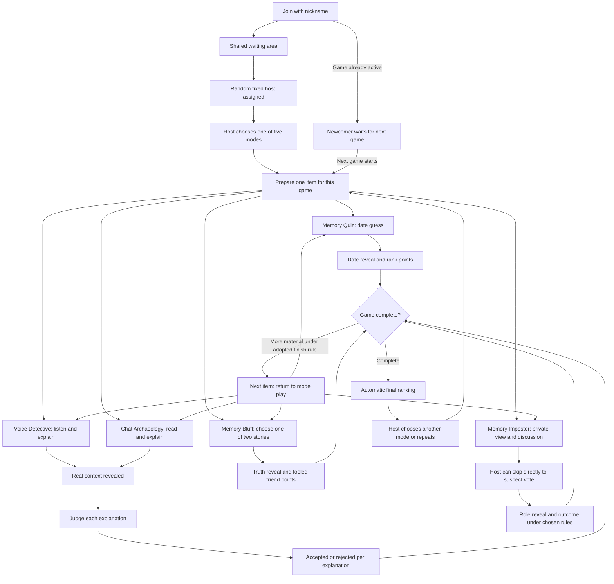

# Photo Fumble — UI concepts for review

Prepared 24 October 2026. **Design proposal, not an implemented game.** No hosting,
deployment, infrastructure, or product defaults are selected by this document.

The [interactive local HTML gallery](../ui-concepts/index.html) and [70-image index](../ui-concepts/images.html) now implement these visual concepts for review. See the
[complete screen-selection and delivery plan](UI_REVIEW_PLAN.md) for the 23 screen
groups, role variants, actual exports, and limitations. These are fixture-based
mockups, without multiplayer, uploads, storage, or deployment. All names, dates,
stories, votes and results are fictional. The stock photo is a visual stand-in,
not evidence for the fictional story.

Sources of truth: [PRD](PRD.md), [agreed decisions](GAME_DESIGN.md),
[glossary](../GLOSSARY.md), [UI research](UI_RESEARCH.md), and
[UI handoff](UI_HANDOFF.md). Confirmed rules remain confirmed; proposals below do not
resolve open product decisions.

## Recommended starting direction

**Pocket Prints** is the recommended starting point: energetic enough for a party,
bright enough for a phone passed around a table, and recognizably built around photos.
**After Hours** offers a quieter, more suspenseful alternative for friends playing
over a call. Review both against the same gameplay content before choosing either.

## Screen and state map



The next-item edge returns to play, **not** to uploading again. A game uses one
prepared item per participant; how many items constitute a completed game is still
open. The “each item once” loop is a PRD proposal, not an agreed round count. No
numbered-round settings screen is added.

| Screen/state | Shared information and primary action | Role differences / guardrail |
| --- | --- | --- |
| Join | Nickname; “Join friends”. | One shared session, no account or room-code step. Guest browser identity is proposed. |
| Waiting area / bootstrap | Friend list and readiness; “I'm ready” is a proposed bootstrap control. | Show “Host is picked at random when the group is ready.” The ready threshold and trigger need adoption. |
| Mode selection | Five named modes, each with the action and one required media item. | Host selects; other players see “Maya is choosing a mode”. The randomly chosen host stays host. |
| Preparation | Select one file, exact preview, replace, private inputs, readiness count, “I'm ready”. | Correct date / context / story truth stay private. No multi-mode upload checklist. |
| Prepared / waiting | “Your photo is ready”; “4 of 6 ready”. | No preview of other people's private answers; host starts when the chosen readiness rule permits. |
| Active play | Dominant media and one task. Submission count without answers or vote tallies. | Quiz uploader presents and does not guess; Voice/Chat invite others to explain; Bluff invites others to choose. No uploader exclusion is assumed for Impostor. Host authority adds no secrets. |
| Locked / waiting | The player's own response and “Guess locked” / “Vote locked”; count received. | No leading answer or interim ranking. Whether editing is allowed remains open. |
| Context reveal | Actual context, followed by the explanation being judged. | Voice/Chat real context is visible **before** any judging controls appear. |
| Judging | “Close enough” / “Not close”; the explanation author and eligible-vote progress. | Uploader sees “You shared this recording; you sit out judging”. Self-judging remains unresolved. |
| Impostor discussion | Each player sees only their assigned clear photo or blurred derivative. | No shared-TV dependency; no public role badge; no required speaking checklist. Host alone has “Skip to vote”. |
| Suspect voting | Recognizable player names and one selection; “Lock vote”. | Count participation, hide choices until the agreed reveal. Eligibility and aggregation details remain open. |
| Item reveal | Answer/context/role and a transparent explanation of this item's outcome. | Host can advance to another item if the game is not complete. Voice/Chat points and Impostor outcome use unresolved-rule placeholders in concepts. |
| Final ranking | Completed mode, full ordered group, current player, point totals, shared winners. | Automatically appears on game completion. No hide/reveal-results switch. Host sees next-mode / repeat choices only **after** it appears. Others wait. |
| Newcomer waiting | “You're in for the next game”; active mode and host name. | No media, private role, guesses, judging, or suspect-vote controls from the active game. Admit on next game start. |
| Upload failed | Preview/input retained where possible; useful error; “Try upload again” / “Choose another file”. | Retry does not add a second contribution. Limits/formats need confirmation. |
| Connection lost / reconnecting | “Reconnecting…”; last confirmed phase; “Try reconnecting”. | Disable uncertain submissions; recover identity and server-confirmed state before resuming. Pause if host leaves is a PRD proposal. |

Host, uploader, guesser, and impostor are overlapping capabilities, not mutually
exclusive public identities. For example, Maya can be both host and uploader, but
cannot guess on her own Quiz photo or judge her own Voice/Chat upload.

## Five-mode interaction contract

| Mode | Prepare one item | Play / vote | Reveal and scoring |
| --- | --- | --- | --- |
| Memory Quiz | Photo + privately entered correct date. Native full-date entry is a **layout proposal**, pending precision choice. | Non-uploaders enter a date and lock it. Uploader sees “Your photo; friends are guessing”. No speed-score meter or assumed timer. | Reveal the correct date; show signed date gaps and accuracy ranks. Equally distant guesses use submission speed, even on opposite sides of truth. Accuracy outranks speed. Points 3 / 2 / 1 / 0; no penalty. |
| Voice Detective | One uploaded recording + private real context; visible playback preview. | User-initiated play/pause/seek; short typed explanation is **proposed**. Lock → context revealed → judge each explanation. | More yes than no accepts; a split rejects **that explanation**, with no effect on other accepted ones. Uploader excluded. Points remain “To decide” until adopted. |
| Chat Archaeology | One screenshot + private context; proposed crop/cover tools + exact shared preview. | Read anonymized speakers, enlarge without losing task position, explain; same judging flow as Voice. | Same per-explanation majority/tie behavior and uploader exclusion. Screenshot sent to players must actually omit speaker identities. Automatic anonymization is not assumed. |
| Memory Bluff | One photo + exactly two stories, privately designated true and false. | Two equally styled choices, neutral labels “Story A” / “Story B”; no position convention reveals truth. Others choose and lock. | Reveal true story and each choice's voters. Storyteller: 2 per fooled friend; true-story guesser: 1. Example: 3 fooled × 2 = 6. |
| Memory Impostor | One uploaded photo each; no library prerequisite. | Clear photo to most; one player gets a blurred version of that **same** photo. Discuss aloud; host can skip immediately to suspect vote. | Reveal role; outcome, points, vote ties, and game length await product decisions. Final ranking remains required after the chosen scoring rule is applied. No invented “caught = win” behavior. |

### Quiz reveal fixture

Fictional correct date: 10 June 2023. Jules guesses 9 June, Sam guesses 11 June.
Both are one day away; Jules submitted first and earns 3, Sam earns 2. Noor is two
days away and earns 1. Eli is eight days away and earns 0. If Noor had guessed the
exact date later than Jules, Noor would rank first. This explanation is available at
reveal, without exposing answer-bearing metadata before it.

### Subjective judging fixture

“We missed our train” receives 2 close / 2 not close → rejected. A separate
explanation, “A platform announcement interrupted the birthday song,” receives
3 close / 1 not close → accepted. These examples illustrate confirmed judging only;
they do not decide self-judging eligibility or point values. The board does
not imply these are simultaneous tallies from its six-person preview roster.

## Direction A — Pocket Prints

**Idea:** the anticipation of opening a friend's envelope of prints. The media stays
upright; paper edges appear only around the frame, and small overlapping thumbnails
belong in the lobby or celebration, never over a clue. Bold condensed type provides
party energy without a cartoon avatar system.

| Token | Value / role |
| --- | --- |
| Photo paper | `#F7FAFF` — bright, slightly cool page base |
| Album blue | `#234BC8` — principal controls and wordmark |
| Ink | `#182443` — body and headings |
| Rose | `#B82954` — secondary marker; never meaning alone |
| Flash yellow | `#F5D765` — emphasis behind a result or selected tab, with ink text |
| Sea glass | `#DCEFE8` — quiet ready/accepted surfaces with ink text |
| Type | DIN Condensed Bold for display; Avenir Next for body, buttons, and numeric scores. Arial Narrow / system sans fallbacks. |
| Scale | Display 72–88 desktop / 44–52 phone; task 28–36 / 24–30; body 16–18; support 13–14. No tracked all-caps labels. |
| Space / shape | 8 / 16 / 24 / 32 / 48 px spacing. Image frame 6 px; action 14 px; player identity circular. Restrained hard offset edge only on the photo mount. |
| Alignment | Left-align task copy and controls. Centre only the nickname invitation, individual photo, and winner headline. |

```text
Desktop                               Phone
Photo Fumble      friends + host       Photo Fumble       friends
Memory Quiz       4 of 5 submitted     Memory Quiz
┌──────────────────┐ ┌────────────┐   ┌──────────────────────┐
│                  │ │ When was   │   │       Photo          │
│      Photo       │ │ this?      │   └──────────────────────┘
│                  │ │ Date       │   When was this taken?
└──────────────────┘ │ Lock guess │   [Date               ]
from Maya            └────────────┘   [Lock guess           ]
Friends / readiness                    4 of 5 guesses locked
```

**Characteristic interaction:** after “Lock guess,” the action area becomes a small
receipt: the player's own date, a check mark, and the group's submission count. A
single 160 ms settle confirms the lock; no card flies across the screen or hides the
media. A static check mark is the reduced-motion equivalent.

## Direction B — After Hours

**Idea:** friends gathering for a late-night screening of their own memories. A plum
surround recedes behind a generous media aperture; a pale lilac task panel makes the
next action unmissable. The single expressive motif is the broad curved aperture
edge, reused at the reveal, rather than neon glows or glass cards.

| Token | Value / role |
| --- | --- |
| Screening plum | `#2D2038` — page base; visibly plum rather than tinted black |
| Projection lilac | `#D9C9F3` — primary action with plum text |
| Screen white | `#FFF9FF` — task-panel and high-contrast text |
| Soft mauve | `#BDAFC8` — supporting text on plum |
| Peach light | `#F4B69B` — result emphasis with plum text |
| Seat violet | `#44324F` — quiet secondary surfaces |
| Type | Futura Medium for display and task titles; Avenir Next for body/actions. Century Gothic / system sans fallbacks. |
| Scale | Display 56–72 desktop / 38–44 phone; task 28–32 / 24–28; body 16–18; support 13–14. Comfortable line height and no long uppercase runs. |
| Space / shape | 8 / 12 / 24 / 40 / 64 px spacing. 36 px on the media aperture, 12 px task panel, 999 px primary action. No generic glow or gradient wash. |
| Alignment | Media and title centred within their own stage; task body and inputs left-aligned. Desktop action panel sits beside, not on top of, the image. |

```text
Desktop                               Phone
Photo Fumble            friends        Photo Fumble       friends
          Memory Bluff                 Memory Bluff
╭────────────────────╮ ┌───────────┐  ╭──────────────────────╮
│                    │ │ Which is  │  │       Photo          │
│       Photo        │ │ true?     │  ╰──────────────────────╯
│                    │ │ Story A   │  Which story is true?
╰────────────────────╯ │ Story B   │  [Story A              ]
from Maya              │ Lock      │  [Story B              ]
                       └───────────┘  (Lock choice           )
```

**Characteristic interaction:** “Reveal” opens a short horizontal aperture inside
the task panel, exposing truth and then score rationale together. The photo stays
stable. Reduced motion swaps content immediately; no hidden clear-image transition
is ever used on an impostor's device.

## Review against the brief before mockup implementation

- Rejected a scattered scrapbook collage: it would obscure actual clues and become
  decorative noise. Pocket Prints uses one straight media mount and a receipt-like
  confirmation. No torn-paper texture, tape stickers, or arbitrary tilt in play.
- Rejected a black/neon “game dashboard” for the second direction: it would fit any
  quiz. After Hours uses plum, lilac, a screening aperture, and players' actual media.
- Removed speed meters, podium-only results, and numbered-round chrome from both.
  They would imply unconfirmed rules or make confirmed scoring harder to read.
- Both directions put real mode tasks on screen rather than a promotional hero.
  Shared chrome keeps identities, host authority, and waiting legible in every mode.
- These are alternative art directions over one flow, not two competing rule sets.

## Representative review walkthrough

The board provides desktop and phone layouts of the same fixture, with direction,
scene, mode and viewer selectors. The comparison sheet shows matching Memory Bluff
screens in both directions. The image index provides settled captures.

1. **Join:** nickname invitation; joined friends; shared waiting area. Preview the
   bootstrap and mode picker separately; host selection is random and fixed.
2. **Prepare:** switch modes to see the single photo/date, recording/context,
   screenshot/redaction/context, two-story, and Impostor-photo forms.
3. **Play:** Quiz date input; Voice playback; Chat anonymized excerpt; Bluff equal
   story choices; Impostor clear or blurred private view. Inspect uploader and host.
4. **Locked:** use the primary lock action to see the explicit waiting receipt.
5. **Vote:** Voice/Chat already show the actual context above the explanation;
   uploader has no judging controls. Impostor shows suspect selection; only the host
   discussion view exposes “Skip to vote”. Quiz/Bluff have no extra judging step.
6. **Reveal:** inspect Quiz equal-distance/speed reasoning, Bluff 3 × 2, and
   per-explanation Voice/Chat results. Unresolved points/outcomes are annotations.
7. **Final ranking:** every mode has a finale; Quiz/Bluff use illustrative totals,
   Voice/Chat/Impostor have explicit pending score placeholders. Shared winners get
   the same rank; full roster and “You” remain visible. Next-game choices belong to
   the host and show only after results.
8. **Recovery:** newcomer, upload-failed, reconnecting, and host-disconnected fixtures.

The scene selector is **review tooling outside the product canvas**. Its ability to
jump to a screen is not a player control and does not permit skipping final results.

## Motion proposal

All timings are original proposals, not observed timing from a reference product.

| Trigger | Purpose / treatment | Reduced motion |
| --- | --- | --- |
| Upload confirmed | Check mark and filename/preview settle in place, 120–160 ms. | Show the final ready state immediately. |
| Guess/choice/vote locked | Replace action area with a receipt, 160 ms; preserve media position. | Immediate state swap plus text announcement. |
| Truth/context revealed | Pocket Prints exposes a caption; After Hours opens an aperture, 180–220 ms. | Immediate reveal; retain the same reading order. |
| Game completes | Automatically mount final ranking; short winner emphasis, at most 400 ms. | Immediately show settled full ranking. |
| Host skips discussion | Change task to suspect vote; no decorative transition or forced speaking sequence. | Same immediate change. |

No autoplay audio, ticking countdown, moving clues, score-racing animation, or
ambient looping motion. Reveal animations do not delay voting or access to results.
Use polite live announcements for ready/locked/connection states; move focus to the
new phase heading on a synchronized phase change. Respect input focus during counts.

## Open decisions that affect the UI

| Decision | UI consequence / treatment in concepts |
| --- | --- |
| Bootstrap readiness, host-selection trigger, minimum players | Ready lobby and four-player advice are proposals. No hard minimum or host election invented. |
| Finish condition and item order for each game; Impostor photo count | “Next item” is conditional. No fixed total, round picker, or assumed last-photo number. |
| Quiz date precision, simultaneous ordering, timer, edits | Full-date control is illustrative. No timer or guaranteed edit affordance; server ordering required if adopted. |
| Voice/Chat points | “Points to decide” in review fixtures; final ranking score slots remain unfilled rather than implying 1 point is agreed. |
| Self-judging, missing votes, abstentions, completion | Uploader exclusion must be visible. No assumed author exclusion, vote threshold, or “Close voting” button. |
| How explanations are submitted | Typed fields are a proposal; do not add voice chat or AI judging. |
| Chat anonymization tools | Proposed crop/cover + exact preview. Only cleaned shared pixels leave the upload step. |
| Impostor/photo selection and uploader eligibility | No uploader exclusion, visible randomization rule, or outcome inferred. Blur strength requires visual validation. |
| Suspect aggregation/ties, victory, points, final identification chance | Role reveal and ranking layouts are shown; pending outcome and score content must remain explicit review annotations. |
| Upload limits, formats, identity recovery, host departure | Errors give recovery actions without invented limits. Pause on host departure remains proposed; no automatic host rotation. |

## Implementation boundaries and access

- Photo and task split on desktop; single-column mobile with readable content order.
  Controls at least 44 px; no reliance on colour alone; visible keyboard focus.
- Long stories wrap; chat expands inline; photos use `object-fit: contain` so framing
  does not discard clues. No original filename, EXIF date/location, or hidden answer
  in alt text before reveal.
- The actual game server must filter secrets by recipient and phase. A review
  board with access to all fixtures must not be treated as a privacy implementation.
- The prepared Impostor asset is a separately downloaded blurred raster of the same
  source photo. Production must send only the permitted derivative to that player;
  a CSS filter over a clear original is unacceptable.
- The cleaned chat fixture uses synthetic “Speaker 1 / Speaker 2” content,
  with no reversible overlay over actual identities.
- Results reset game scores on the next game, not stored media. Files remain stored
  after results; no auto-deletion message or automatic shared album is introduced.

## Assets and review record

- Sample photo: [Kelvin Zyteng, “Friends enjoy a sunset picnic by the sea”](https://unsplash.com/photos/friends-enjoy-a-sunset-picnic-by-the-sea-b6QEE_6ykp0),
  under the Unsplash License. Downloaded only as a review asset. The blurred preview
  is a raster derivative from the same source image service.
- A synthetic tone file is prepared as an optional audio-control sample. It is not
  a supplied personal recording or evidence of context. Waveform and anonymous chat
  fixtures are authored review content.
- Fonts are platform font stacks; no third-party font files are redistributed.
- Local HTML mockups and settled screenshots are complete. See the review plan and
  `ui-concepts/review/VERIFICATION.md` for the actual inventory and limits.
